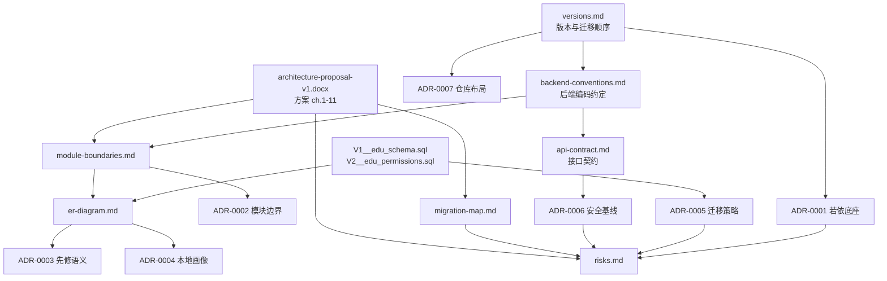

# 架构文档索引（docs/architecture）

本目录描述 CUHK-Shenzhen 学生学业规划平台从静态原型迁移到
**RuoYi-Vue v3.9.2（Spring Boot 4.1.2 + MyBatis + MySQL 8 + Redis）+ 官方 RuoYi-Vue3 TypeScript 前端**
之后的架构。业务特色集中在新模块 `ruoyi-education` 中，若依内核（`ruoyi-system` /
`ruoyi-framework` / `ruoyi-admin`）只做依赖装配级改动。

> 本目录**不是**契约的来源。契约的唯一真源是下面「权威文档」四个文件；
> 本目录其余文档是对契约的解释、推导与决策记录，若与契约冲突，以契约为准并提 PR 修文档。

## 1. 权威文档（契约层）

| 文档 | 它锁定了什么 |
|---|---|
| [`versions.md`](../../versions.md) | 官方底座仓库 / 分支 / 提交号、JDK·Node·MySQL·Redis·前端依赖版本、迁移执行顺序 |
| [`backend-conventions.md`](backend-conventions.md) | Maven 模块与包结构、命名、分层、权限与数据边界、枚举、先修语义、测试、代码生成器改造 |
| [`api-contract.md`](api-contract.md) | 每个 HTTP 接口的路径、参数、返回结构、权限标识、统一响应与错误码 |
| [`backend/sql/edu/V1__edu_schema.sql`](../../backend/sql/edu/V1__edu_schema.sql) + [`V2__edu_permissions.sql`](../../backend/sql/edu/V2__edu_permissions.sql) | 18 张 `edu_` 表的字段/约束/索引、角色、演示账号、菜单与按钮权限标识 |

方案的成因与取舍写在 [`docs/proposal/architecture-proposal-v1.docx`](../proposal/architecture-proposal-v1.docx)
（下称「方案」），本目录的章节编号与术语刻意与之一致：
执行摘要（方案 ch.1）→ 框架选型（ch.2）→ 逻辑分层（ch.3）→ 模块划分（ch.4）→
数据库设计（ch.6）→ 接口与安全（ch.7）→ 风险（ch.10）。

## 2. 本目录文档清单

| 文档 | 回答什么问题 | 主要读者 | 状态 |
|---|---|---|---|
| [`er-diagram.md`](er-diagram.md) | 18 张 `edu_` 表的全景 ER 图、按 6 个业务域分组、索引/约束清单、为什么**没有** `edu_user_profile` | 后端、产品、数据 | 已评审（对应方案 ch.6） |
| [`module-boundaries.md`](module-boundaries.md) | 6 层逻辑分层、Maven 模块图、内核零修改规则、按域分包规则、6 个业务域之间的调用方向、「禁止事项」 | 后端 | 已评审（对应方案 ch.3 / ch.4） |
| [`adr/ADR-0001-ruoyi-vue-baseline.md`](adr/ADR-0001-ruoyi-vue-baseline.md) | 为什么选 RuoYi-Vue 而不是 Cloud / Vue-Plus；为什么后端锁 `master`、前端锁 `typescript` 分支 | 全体 | 已接受 |
| [`adr/ADR-0002-module-boundaries.md`](adr/ADR-0002-module-boundaries.md) | 为什么是 1 个 Maven 模块 6 个包，而不是 6 个 Maven 模块；为什么 Controller 不放进 `ruoyi-admin` | 后端 | 已接受 |
| [`adr/ADR-0003-prerequisite-group-semantics.md`](adr/ADR-0003-prerequisite-group-semantics.md) | 先修关系为什么用 `group_no`（组内 AND / 组间 OR），而不是布尔表达式树 | 后端、数据 | 已接受 |
| [`adr/ADR-0004-local-first-skill-profile.md`](adr/ADR-0004-local-first-skill-profile.md) | 个人技能画像为什么只存浏览器 IndexedDB；跨设备加密同步为什么延后以及复评清单 | 前端、后端、产品 | 已接受 |
| [`adr/ADR-0005-database-migration-strategy.md`](adr/ADR-0005-database-migration-strategy.md) | `V1..V6` 迁移编号、生成式种子、幂等要求、外键/CHECK 策略、旧 SQL 为何退役 | 后端、运维 | 已接受 |
| [`adr/ADR-0006-security-baseline.md`](adr/ADR-0006-security-baseline.md) | 资源级授权 vs 菜单权限、身份只取 JWT、教师/学生归属校验、SSO 如何延后、密钥与账号加固 | 后端、运维 | 已接受 |
| [`adr/ADR-0007-monorepo-layout.md`](adr/ADR-0007-monorepo-layout.md) | 为什么 `backend/` + `frontend/` + `data/` + `pipeline/` + `deploy/` + `docs/` 同仓；离线 ETL 为什么不是运行时模块 | 全体 | 已接受 |
| [`adr/ADR-0008-student-portal-preserves-legacy-design.md`](adr/ADR-0008-student-portal-preserves-legacy-design.md) | 学生端（`/student/**`）保留旧版 HTML 设计、管理端（`/education/**`）用若依表格界面；CSS 用 `.sp-root` 隔离；数据与鉴权换源 | 前端、产品 | 已接受 |
| [`migration-map.md`](migration-map.md) | 旧→新文件映射、分支策略、能力对照表、尚未完成项 | 全体 | 迁移期有效 |
| [`risks.md`](risks.md) | 方案 ch.10 的风险登记册 + 本仓库已有的具体缓解措施落点 | 技术负责人、产品 | 随迭代更新 |

## 3. 推荐阅读顺序

### 3.1 新后端成员（第一周）

```text
versions.md（环境与版本从哪来）
  → backend-conventions.md（代码写在哪、怎么命名、怎么鉴权）
  → module-boundaries.md（能改什么、不能改什么、域之间谁能调谁）
  → er-diagram.md（数据模型与真实外键方向）
  → api-contract.md（对外暴露什么）
  → ADR-0002 / ADR-0003 / ADR-0006（三个最容易踩坑的决策）
  → migration-map.md + risks.md（历史包袱与当前风险）
```

先跑通 `backend/`（启动类 `com.ruoyi.RuoYiApplication`），再读代码；
不要先读若依源码，容易在框架细节里迷路。

### 3.2 新前端成员（第一周）

```text
versions.md（Node / Vite / Vue / Element Plus / TS 版本，别升级）
  → api-contract.md（唯一的联调依据：路径、参数、返回结构、权限标识）
  → README.md（本文件，确认哪些路径已存在、哪些只是约定）
  → ADR-0004（哪些数据不进服务端）
  → er-diagram.md §3（只需要看懂「域 → 表」的对应关系）
  → module-boundaries.md §7（前端与后端的职责切分）
```

### 3.3 新产品 / 课程数据成员

```text
docs/proposal/architecture-proposal-v1.docx（方案原文，先读 ch.1 与 ch.5）
  → migration-map.md（能力对照表 + 尚未完成项，判断 MVP 边界）
  → risks.md（哪些承诺现在还不能给）
  → er-diagram.md §3 / §5（数据边界与「个人画像不进服务端」）
  → docs/workflows/study-progress.md（培养方案规则的生产流程）
```

## 4. 文档之间的关系



实线含义是「被引用」：箭头左侧的文档是右侧文档的输入。

## 5. 路径标记约定（重要）

本目录文档里出现三类路径，请先看清标记再去找文件：

| 标记 | 含义 | 例子 |
|---|---|---|
| 普通路径 | 仓库中**已存在**的文件，可直接打开 | `backend/ruoyi-education/pom.xml` |
| 「约定路径」 | 已在 `backend-conventions.md` / `api-contract.md` / `versions.md` 中定义的位置；当前实现已落地，但文档以契约为准 | `backend/ruoyi-education/src/main/java/com/ruoyi/education/course/controller/EduCourseController.java` |
| 「生成物」 | 由 `pipeline/` 脚本产出、不手工编辑的构建产物 | `backend/sql/edu/V3__edu_seed_course.sql` |

仓库现状如下（已按文件系统核对；`ruoyi-education` 与前端教育页面在本轮重构中已落地）：

| 路径 | 现状 |
|---|---|
| `backend/pom.xml` | 含 `<module>ruoyi-education</module>` 与 `ruoyi-education` 的 dependencyManagement |
| `backend/ruoyi-admin/pom.xml` | 已声明对 `ruoyi-education` 的依赖 |
| `backend/ruoyi-education/pom.xml` | 存在（只依赖 `ruoyi-common` + `spring-boot-starter-test`） |
| `backend/ruoyi-education/src/main/java/com/ruoyi/education/**` | 已实现：`common` + 6 个业务域（`course` / `curriculum` / `enrollment` / `assignment` / `planning` / `analytics`），含 17 个 Mapper XML（`src/main/resources/mapper/education/`） |
| `backend/ruoyi-education/src/test/java/com/ruoyi/education/**` | 已实现纯规则单测：`PrerequisiteGraphTest`、`PlanRuleEngineTest`、`GradeUtilTest` |
| `backend/sql/edu/V1__edu_schema.sql`、`V2__edu_permissions.sql` | 存在（18 张表 / 23 条外键 / 2 条 CHECK；菜单 `menu_id` 2000–2080） |
| `backend/sql/edu/V3..V6` 种子文件 | 生成物，已由 `pipeline/course_import/build_edu_seed.py` 生成（V3 约 3.6 MB、V6 约 750 KB） |
| `frontend/`（官方 RuoYi-Vue3 TS 分支） | 存在；`src/views/education/`（8 个页面）、`src/api/education/`、`src/types/education/`、`src/utils/education/skillProfileDb.ts` 已落地 |
| `frontend/package.json` | 已含 `dexie ^4.0.11`（与 `versions.md` §3 一致） |
| `pipeline/` | 存在（`course_import` 含 `build_edu_seed.py`、`competency`、`career`、`graduation_rules`、`sis-crawler`） |
| `data/` | 存在（`course_catalog`、`demo`、`competency`、`graduation_rules`、`career`、`reference`） |
| `deploy/` | 已落地：`docker-compose.yml`、`backend.Dockerfile`、`frontend.Dockerfile`、`nginx/nginx.conf`、`.env.example`、`mysql/init/README.md` |
| `docs/legacy-reference/` | 存在（旧 JS 引擎与规则数据，只作语义参考） |

## 6. 写文档的规则

1. **不重复契约**。接口字段抄在 ADR 里就会过期，只写「为什么」并链接契约。
2. **每个决策要能回答「不这样做会怎样」**。ADR 的「Alternatives considered」是硬性章节。
3. **路径必须可验证**。新引入的路径先 `glob` 确认，再写进文档；未落地的实现写「约定路径」。
4. **图只画结构，不画细节**。字段级信息放表格，Mermaid 只承担关系与方向。
