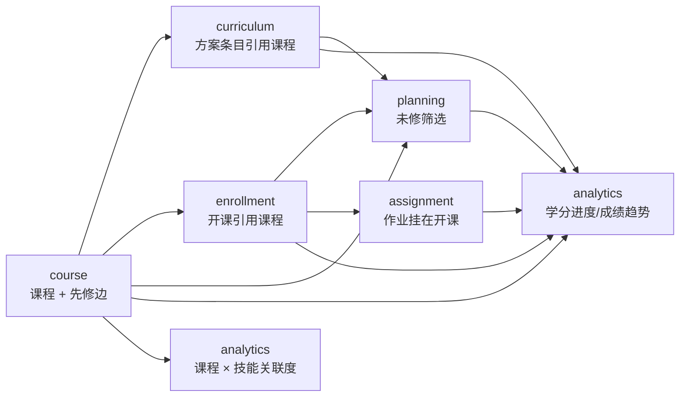

# 教育业务数据模型（ER 图与索引清单）

> 事实来源：[`backend/sql/edu/V1__edu_schema.sql`](../../backend/sql/edu/V1__edu_schema.sql)。
> 本文是**描述性**文档：字段、约束、索引一律以 SQL 为准；两者不一致时改本文并提 PR。
> 本文对应方案 ch.6「核心数据库设计」，章节编号沿用方案。

## 1. 范围

| 项目 | 说明 |
|---|---|
| 表数量 | 18（全部 `edu_` 前缀） |
| 字符集 | `utf8mb4`（`SET NAMES utf8mb4`），支持中英文课程名 |
| 存储引擎 | 全部 `InnoDB` |
| 外键数量 | 23 条（全部指向 `edu_` 表内部） |
| CHECK 约束 | 2 条（`ck_prereq_not_self`、`ck_record_units`） |
| 若依基础表 | `sys_user` / `sys_role` / `sys_menu` / `sys_user_role` / `sys_dept` 见 [`backend/sql/ry_20260417.sql`](../../backend/sql/ry_20260417.sql)，本文不重复 |
| 刻意缺失 | `edu_user_profile`（见第 7 节） |

若依基础表与教育表之间**不建外键**：`edu_student.sys_user_id`、`edu_teacher.sys_user_id`、
`edu_teacher.dept_id`、`edu_sso_identity.sys_user_id` 都是逻辑关联。原因是若依基础表要能被
官方升级脚本重放，不该被业务库的外键级联锁死（详见第 7 节与 ADR-0005）。

## 2. 全景 ER 图

关系标签写的是**子表外键列 + 删除策略**；箭头方向与 V1 的真实外键方向一致（父表在左，子表在右）。
`sys_user` 只画出被引用关系，其字段属于若依基础表。

```mermaid
erDiagram
    edu_major ||--o{ edu_curriculum : "major_id 限制删除"
    edu_major ||--o{ edu_student : "major_id 置空"
    edu_course ||--o{ edu_course_prereq : "course_id 级联删除"
    edu_course ||--o{ edu_course_prereq : "prereq_course_id 级联删除"
    edu_course ||--o{ edu_curriculum_item : "course_id 置空"
    edu_course ||--o{ edu_course_offering : "course_id 级联删除"
    edu_course ||--o{ edu_course_record : "course_id 置空"
    edu_course ||--o{ edu_study_plan_item : "course_id 级联删除"
    edu_course ||--o{ edu_course_competency : "course_id 级联删除"
    edu_curriculum ||--o{ edu_curriculum_item : "curriculum_id 级联删除"
    edu_term ||--o{ edu_course_offering : "term_id 限制删除"
    edu_term ||--o{ edu_course_record : "term_id 置空"
    edu_term ||--o{ edu_study_plan : "term_id 限制删除"
    edu_student ||--o{ edu_enrollment : "student_id 级联删除"
    edu_student ||--o{ edu_course_record : "student_id 级联删除"
    edu_student ||--o{ edu_submission : "student_id 级联删除"
    edu_student ||--o{ edu_study_plan : "student_id 级联删除"
    edu_teacher ||--o{ edu_course_offering : "teacher_id 置空"
    edu_course_offering ||--o{ edu_enrollment : "offering_id 级联删除"
    edu_course_offering ||--o{ edu_assignment : "offering_id 级联删除"
    edu_assignment ||--o{ edu_submission : "assignment_id 级联删除"
    edu_study_plan ||--o{ edu_study_plan_item : "plan_id 级联删除"
    edu_skill_tag ||--o{ edu_course_competency : "skill_tag_id 级联删除"
    sys_user ||--|| edu_student : "sys_user_id 逻辑关联 无外键"
    sys_user ||--|| edu_teacher : "sys_user_id 逻辑关联 无外键"
    sys_user ||--o{ edu_sso_identity : "sys_user_id 逻辑关联 无外键"

    edu_major {
        bigint major_id PK "专业ID"
        varchar major_code UK "专业编码"
        varchar major_name_zh
        varchar major_name_en
        varchar school_abbr "学院缩写 SDS-SME"
        decimal duration_years "标准学制"
        char status "0正常 1停用"
        char del_flag
    }

    edu_course {
        bigint course_id PK "课程ID"
        varchar code UK "课程代码 CSC1001"
        varchar title_zh
        varchar title_en
        varchar subject "SIS subject"
        decimal credits "学分"
        int level "由课程代码推算"
        varchar category "Major-GenEd-English-IT-PE"
        varchar school "开课学院"
        varchar prereq_text "SIS 先修原文"
        varchar coreq_text "SIS 共修原文"
        char del_flag
    }

    edu_course_prereq {
        bigint id PK
        bigint course_id FK "被约束课程"
        bigint prereq_course_id FK "先修课程"
        int group_no "组内AND 组间OR"
        varchar raw_text "SIS 原文片段"
    }

    edu_curriculum {
        bigint curriculum_id PK
        bigint major_id FK
        varchar version_label "2025-26 and thereafter"
        int version_year "生效入学年份"
        int effective_from
        int effective_to "null 表示一直有效"
        decimal total_credits "毕业总学分"
        decimal major_credits "专业学分"
        varchar source_doc "来源文件名"
    }

    edu_curriculum_item {
        bigint item_id PK
        bigint curriculum_id FK
        bigint course_id FK "可为空 纯学分池"
        varchar course_code "课程代码快照"
        varchar requirement_type "REQUIRED-ELECTIVE-GE-BREADTH-DEPTH-STREAM"
        varchar section "方案章节名"
        varchar stream "方向"
        decimal min_units
        int sort_order
    }

    edu_term {
        bigint term_id PK
        varchar term_code UK "2026-27-1"
        varchar term_name
        varchar academic_year
        int term_index "1-2-3暑期"
        date start_date
        date end_date
        char is_current
    }

    edu_student {
        bigint student_id PK
        bigint sys_user_id UK "逻辑关联 sys_user"
        varchar student_no UK "学号"
        varchar name
        bigint major_id FK
        int entry_year "决定培养方案版本"
        varchar college "书院"
        decimal cum_gpa "演示字段"
        decimal total_credits "演示字段"
    }

    edu_teacher {
        bigint teacher_id PK
        bigint sys_user_id UK "逻辑关联 sys_user"
        varchar teacher_no UK "教工号"
        varchar name
        bigint dept_id "逻辑关联 sys_dept"
        varchar school
        varchar title
    }

    edu_course_offering {
        bigint offering_id PK
        bigint course_id FK
        bigint term_id FK
        bigint teacher_id FK "授课教师 归属校验依据"
        int capacity
        int enrolled_count
        varchar schedule_text
        char status "0开放 1关闭"
    }

    edu_enrollment {
        bigint enrollment_id PK
        bigint student_id FK
        bigint offering_id FK
        varchar status "ENROLLED-DROPPED-COMPLETED"
        datetime enrolled_at
    }

    edu_course_record {
        bigint record_id PK
        bigint student_id FK
        bigint course_id FK "可为空"
        varchar course_code "课程代码快照"
        varchar course_title
        bigint term_id FK "可为空"
        varchar grade "A- B+"
        decimal score
        decimal units
        char passed
        varchar record_status "COMPLETED-IN_PROGRESS-WITHDRAWN"
        varchar source "SIS_IMPORT-DEMO-MANUAL"
    }

    edu_assignment {
        bigint assignment_id PK
        bigint offering_id FK
        varchar title
        datetime due_at
        decimal total_score
        varchar status "DRAFT-PUBLISHED-CLOSED"
    }

    edu_submission {
        bigint submission_id PK
        bigint assignment_id FK
        bigint student_id FK
        datetime submitted_at
        decimal grade
        varchar feedback
        varchar status "SUBMITTED-GRADED-RETURNED"
    }

    edu_study_plan {
        bigint plan_id PK
        bigint student_id FK
        bigint term_id FK
        varchar title
        varchar status "DRAFT-VALIDATED-SUBMITTED-ARCHIVED"
        decimal total_units
        decimal unit_limit "默认 21.0"
        varchar validation_state "PASS-WARN-FAIL"
    }

    edu_study_plan_item {
        bigint item_id PK
        bigint plan_id FK
        bigint course_id FK
        varchar reason "可解释推荐理由"
        varchar validation_status "VALID-WARN-INVALID-UNKNOWN"
        varchar validation_message "缺少的先修课等"
        int sort_order
    }

    edu_skill_tag {
        bigint skill_tag_id PK
        varchar code UK
        varchar name
        varchar category "学院-能力域"
        varchar school_abbr
        varchar keywords "匹配关键词"
    }

    edu_course_competency {
        bigint id PK
        bigint course_id FK
        bigint skill_tag_id FK
        decimal score "关联度 0-10"
        varchar level "Very high-High-Moderate-Low"
        varchar rationale
        varchar matched_keywords
    }

    edu_sso_identity {
        bigint identity_id PK
        bigint sys_user_id "逻辑关联 sys_user"
        varchar provider "CUHKSZ_OIDC"
        varchar external_subject "外部唯一标识"
        datetime bound_at
        char status
    }

    sys_user {
        bigint user_id PK
        varchar user_name
    }
```



## 3. 按业务域分组

分组与 `backend-conventions.md` §1 的 6 个 Java 包一一对应。
`edu_sso_identity` 没有业务域归属（SSO 延后，见 ADR-0006）。

| 业务域 | 表 | 为什么归在这里 | 后端包（约定路径） |
|---|---|---|---|
| **course**<br/>课程目录与先修关系 | `edu_course`<br/>`edu_course_prereq` | 先修边是课程之间的自反关系，与课程目录同生命周期；先修图由 `PrerequisiteGraph` 一次载入 | `com.ruoyi.education.course` |
| **curriculum**<br/>培养方案与学分要求 | `edu_major`<br/>`edu_curriculum`<br/>`edu_curriculum_item` | 方案按「专业 + 入学年份」定版；条目可以只有学分要求而没有具体课程（纯学分池） | `com.ruoyi.education.curriculum` |
| **enrollment**<br/>学期、开课、选课、成绩 | `edu_term`<br/>`edu_student`<br/>`edu_teacher`<br/>`edu_course_offering`<br/>`edu_enrollment`<br/>`edu_course_record` | 选课是「学生 × 开课」的关系，成绩是学籍侧事实；学号/教工号与 `sys_user` 的一对一映射也在这里 | `com.ruoyi.education.enrollment` |
| **assignment**<br/>作业与提交 | `edu_assignment`<br/>`edu_submission` | 作业挂在开课上，提交挂在作业上；教师归属校验复用 `edu_course_offering.teacher_id` | `com.ruoyi.education.assignment` |
| **planning**<br/>规划、推荐、校验 | `edu_study_plan`<br/>`edu_study_plan_item` | 规划项是「学生意图」而非事实，允许 INVALID；`reason` / `validation_*` 把规则结论落库以保证可解释性 | `com.ruoyi.education.planning` |
| **analytics**<br/>学情与技能统计 | `edu_skill_tag`<br/>`edu_course_competency` | 学院能力池是公共参考数据（课程 × 技能关联度），个人画像不在库里 | `com.ruoyi.education.analytics` |
| **跨域（无归属）** | `edu_sso_identity` | 只做「外部身份 ↔ 平台用户」映射，不承载业务规则；启用时按 ADR-0006 的映射层实现 | 约定路径 `com.ruoyi.education.common`（身份映射工具） |

数据流向（读方向）：



`analytics` 是唯一的正方形（没有其他域读它）；`course` 是唯一的源头（不读任何业务域）。
这个方向在 [`module-boundaries.md`](module-boundaries.md) §5 被写成硬规则。

## 4. 与方案 ch.6 的差异：15 张 → 18 张

方案 ch.6 的草案列了 15 张表。V1 落地时补了 3 张，理由如下（评审时逐条确认过）：

| 新增表 | 方案原文的问题 | 补充理由 |
|---|---|---|
| `edu_major` | `edu_curriculum.major_id` 没有主表，专业只能靠字符串 | 专业是「学院 ↔ 培养方案 ↔ 学生」的连接点；`school_abbr` 支撑学院能力池筛选，`duration_years` 支撑预计毕业学期 |
| `edu_term` | 学期以 `term_code` 字符串散落在开课/成绩/规划里 | 学期是真实的业务实体（起止日期、是否当前学期、学期序号），需要被外键引用并支持「当前学期」查询 |
| `edu_course_competency` | 方案只列了 `edu_skill_tag`，没有课程-技能关联 | 学院能力池与「单门课程的技能关联明细」两个接口都需要 `(course_id, skill_tag_id) → score/level/rationale`；只靠标签无法回答「哪门课贡献了这个能力」 |

方案表 9 里 `edu_student.id` / `edu_teacher.id` 等字段名在 V1 中统一为 `student_id` /
`teacher_id`（与若依主键命名一致，见 `backend-conventions.md` §3）。

## 5. 索引与约束清单

`类型` 列含义：**PK** 主键、**UK** 唯一键、**KEY** 普通索引、**CHECK** 检查约束。
外键在下一节单独列出（外键同时会隐式创建索引，但 InnoDB 对已有列前缀索引时复用，不重复创建）。

| 表 | 名称 | 类型 | 列 | 用途 |
|---|---|---|---|---|
| `edu_major` | `PRIMARY` | PK | `major_id` | 主键，被 `edu_curriculum` / `edu_student` 引用 |
| `edu_major` | `uk_major_code` | UK | `major_code` | 专业编码唯一；导入与外部对账的稳定键 |
| `edu_course` | `PRIMARY` | PK | `course_id` | 主键，被 6 张表引用 |
| `edu_course` | `uk_course_code` | UK | `code` | 课程代码唯一；`/edu/courses/byCode/{code}` 与种子生成的对账键 |
| `edu_course` | `idx_course_subject` | KEY | `subject` | 课程中心按学科筛选 |
| `edu_course` | `idx_course_school` | KEY | `school` | 按开课学院筛选（学院能力池联动） |
| `edu_course` | `idx_course_level` | KEY | `level` | 层级筛选；先修规则里「2000 及以上算 Major GPA」这类判断 |
| `edu_course` | `idx_course_category` | KEY | `category` | 按 Major/GenEd/English/… 分类筛选与学分分类统计 |
| `edu_course_prereq` | `PRIMARY` | PK | `id` | 主键 |
| `edu_course_prereq` | `uk_course_prereq` | UK | `course_id`, `prereq_course_id` | 同一对课程只能有一条边；**保证先修图是无重边的有向图** |
| `edu_course_prereq` | `idx_prereq_target` | KEY | `prereq_course_id` | 反向查询「这门课是谁的先修」，用于反查与环检测遍历 |
| `edu_course_prereq` | `ck_prereq_not_self` | CHECK | `course_id <> prereq_course_id` | 禁止自依赖；数据库层兜底，应用层写入前再校验一次 |
| `edu_curriculum` | `PRIMARY` | PK | `curriculum_id` | 主键 |
| `edu_curriculum` | `uk_curriculum_version` | UK | `major_id`, `version_year` | 一个专业一个入学年份只能有一个生效版本，避免「学生匹配到两个方案」 |
| `edu_curriculum_item` | `PRIMARY` | PK | `item_id` | 主键 |
| `edu_curriculum_item` | `idx_item_curriculum` | KEY | `curriculum_id` | 按方案加载全部条目（详情页、进度计算的主路径） |
| `edu_curriculum_item` | `idx_item_course` | KEY | `course_id` | 反查「这门课被哪些方案要求」，用于课程详情页与删除前检查 |
| `edu_term` | `PRIMARY` | PK | `term_id` | 主键 |
| `edu_term` | `uk_term_code` | UK | `term_code` | 学期代码唯一（`2026-27-1`）；导入与成绩对齐的稳定键 |
| `edu_student` | `PRIMARY` | PK | `student_id` | 主键，被 4 张表引用 |
| `edu_student` | `uk_student_no` | UK | `student_no` | 学号唯一；成绩单导入的对账键 |
| `edu_student` | `uk_student_sys_user` | UK | `sys_user_id` | **一对一**：一个平台账号只能绑一个学籍。所有 `me` 接口靠它把 `SecurityUtils.getUserId()` 翻译成 `student_id` |
| `edu_student` | `idx_student_major` | KEY | `major_id` | 按专业统计（培养方案覆盖人数、同专业对比） |
| `edu_student` | `idx_student_entry_year` | KEY | `entry_year` | 按入学年份匹配培养方案版本（`/edu/curricula/by-major`） |
| `edu_teacher` | `PRIMARY` | PK | `teacher_id` | 主键 |
| `edu_teacher` | `uk_teacher_no` | UK | `teacher_no` | 教工号唯一 |
| `edu_teacher` | `uk_teacher_sys_user` | UK | `sys_user_id` | **一对一**：一个平台账号只能绑一个教师身份，教师端 `me` 接口的翻译依据 |
| `edu_course_offering` | `PRIMARY` | PK | `offering_id` | 主键，被选课与作业引用 |
| `edu_course_offering` | `uk_offering_course_term` | UK | `course_id`, `term_id` | 同一课程同一学期只开一个班；选课幂等与容量计算的前提 |
| `edu_course_offering` | `idx_offering_term` | KEY | `term_id` | 按学期列开课（选课页主查询） |
| `edu_course_offering` | `idx_offering_teacher` | KEY | `teacher_id` | `/edu/offerings/mine` 的教师归属查询 |
| `edu_enrollment` | `PRIMARY` | PK | `enrollment_id` | 主键 |
| `edu_enrollment` | `uk_enrollment` | UK | `student_id`, `offering_id` | 不能重复选同一门开课；退课后再选走状态更新而非新增行 |
| `edu_enrollment` | `idx_enrollment_offering` | KEY | `offering_id` | 按开课统计人数 / 教师看选课名单 |
| `edu_enrollment` | `idx_enrollment_status` | KEY | `status` | 过滤 `ENROLLED` / `DROPPED`，用于当前在修课程 |
| `edu_course_record` | `PRIMARY` | PK | `record_id` | 主键 |
| `edu_course_record` | `uk_record_student_course_term` | UK | `student_id`, `course_code`, `term_id` | 成绩单去重。**用 `course_code` 而不是 `course_id`**：课程目录未命中时成绩仍可入库（见 §8 第 1 条） |
| `edu_course_record` | `idx_record_student` | KEY | `student_id` | 本人成绩单主查询 |
| `edu_course_record` | `idx_record_course` | KEY | `course_id` | 按课程反查修读记录（课程热度、成绩分布） |
| `edu_course_record` | `idx_record_term` | KEY | `term_id` | 按学期聚合 GPA 趋势 |
| `edu_course_record` | `ck_record_units` | CHECK | `units >= 0` | 学分为负会污染所有学分统计 |
| `edu_assignment` | `PRIMARY` | PK | `assignment_id` | 主键 |
| `edu_assignment` | `idx_assignment_offering` | KEY | `offering_id` | 按开课列作业（教师端、待办统计） |
| `edu_submission` | `PRIMARY` | PK | `submission_id` | 主键 |
| `edu_submission` | `uk_submission` | UK | `assignment_id`, `student_id` | 一次作业一个学生一条提交；重复提交=更新同一行 |
| `edu_submission` | `idx_submission_student` | KEY | `student_id` | 学生端「我的提交」 |
| `edu_study_plan` | `PRIMARY` | PK | `plan_id` | 主键 |
| `edu_study_plan` | `uk_plan_student_term` | UK | `student_id`, `term_id` | 一个学生一个学期一份规划；`POST /edu/plans` 的幂等依据 |
| `edu_study_plan` | `idx_plan_student` | KEY | `student_id` | 学生规划列表 |
| `edu_study_plan` | `idx_plan_term` | KEY | `term_id` | 按学期统计规划提交情况 |
| `edu_study_plan_item` | `PRIMARY` | PK | `item_id` | 主键 |
| `edu_study_plan_item` | `uk_plan_item` | UK | `plan_id`, `course_id` | 同一规划内课程不重复；支撑「覆盖式保存」用 upsert |
| `edu_study_plan_item` | `idx_plan_item_course` | KEY | `course_id` | 反查「这门课被多少人规划」，用于推荐热度与冲突分析 |
| `edu_skill_tag` | `PRIMARY` | PK | `skill_tag_id` | 主键 |
| `edu_skill_tag` | `uk_skill_tag_code` | UK | `code` | 标签编码唯一；生成器幂等 upsert 的对账键 |
| `edu_skill_tag` | `idx_skill_tag_category` | KEY | `category` | 按能力域分组展示雷达图/能力池 |
| `edu_course_competency` | `PRIMARY` | PK | `id` | 主键 |
| `edu_course_competency` | `uk_course_competency` | UK | `course_id`, `skill_tag_id` | 一对课程-标签只有一条关联度 |
| `edu_course_competency` | `idx_competency_skill` | KEY | `skill_tag_id` | 按技能反查课程（能力池 → 课程推荐的读方向） |
| `edu_sso_identity` | `PRIMARY` | PK | `identity_id` | 主键 |
| `edu_sso_identity` | `uk_sso_provider_subject` | UK | `provider`, `external_subject` | 外部身份（IdP + subject）全局唯一，防止一个学校账号绑到两个人 |
| `edu_sso_identity` | `uk_sso_user_provider` | UK | `sys_user_id`, `provider` | 一个平台用户在同一个 IdP 下只能有一个身份 |

### 5.1 外键方向与删除策略

「方向」一律是 子表 → 父表。三种 `ON DELETE` 策略各自对应一种业务判断：

| 外键 | 子表.列 → 父表.列 | 删除策略 | 为什么这样选 |
|---|---|---|---|
| `fk_prereq_course` | `edu_course_prereq.course_id` → `edu_course.course_id` | CASCADE | 课程没了，它的先修边没有意义 |
| `fk_prereq_target` | `edu_course_prereq.prereq_course_id` → `edu_course.course_id` | CASCADE | 先修课被删时，指向它的边必须一起清理，否则图里出现悬空点 |
| `fk_curriculum_major` | `edu_curriculum.major_id` → `edu_major.major_id` | RESTRICT | 专业还有生效方案时不允许删专业（会让学生匹配不到版本） |
| `fk_item_curriculum` | `edu_curriculum_item.curriculum_id` → `edu_curriculum.curriculum_id` | CASCADE | 条目是方案的组成部分 |
| `fk_item_course` | `edu_curriculum_item.course_id` → `edu_course.course_id` | SET NULL | 条目保留（`course_code` 快照还在），只是不再指向具体课程 |
| `fk_student_major` | `edu_student.major_id` → `edu_major.major_id` | SET NULL | 学生不能因为专业被删而消失；专业置空后由管理员补录 |
| `fk_offering_course` | `edu_course_offering.course_id` → `edu_course.course_id` | CASCADE | 课程删了，开课也失效 |
| `fk_offering_term` | `edu_course_offering.term_id` → `edu_term.term_id` | RESTRICT | 学期承载开课、成绩、规划三类历史事实，不允许被误删 |
| `fk_offering_teacher` | `edu_course_offering.teacher_id` → `edu_teacher.teacher_id` | SET NULL | 教师离职不等于课程没开；开课保留、待重新指派 |
| `fk_enrollment_student` | `edu_enrollment.student_id` → `edu_student.student_id` | CASCADE | 学籍删除时选课关系无意义 |
| `fk_enrollment_offering` | `edu_enrollment.offering_id` → `edu_course_offering.offering_id` | CASCADE | 开课删除时选课关系无意义 |
| `fk_record_student` | `edu_course_record.student_id` → `edu_student.student_id` | CASCADE | 同上 |
| `fk_record_course` | `edu_course_record.course_id` → `edu_course.course_id` | SET NULL | **成绩是历史事实，不能因为课程目录变动而丢**（`course_code` 快照兜底） |
| `fk_record_term` | `edu_course_record.term_id` → `edu_term.term_id` | SET NULL | 同上，学期可空（转入/交换成绩可能无学期） |
| `fk_assignment_offering` | `edu_assignment.offering_id` → `edu_course_offering.offering_id` | CASCADE | 作业属于开课 |
| `fk_submission_assignment` | `edu_submission.assignment_id` → `edu_assignment.assignment_id` | CASCADE | 提交属于作业 |
| `fk_submission_student` | `edu_submission.student_id` → `edu_student.student_id` | CASCADE | 提交属于学生 |
| `fk_plan_student` | `edu_study_plan.student_id` → `edu_student.student_id` | CASCADE | 规划属于学生 |
| `fk_plan_term` | `edu_study_plan.term_id` → `edu_term.term_id` | RESTRICT | 规划是提交过的承诺，学期不能被删掉 |
| `fk_plan_item_plan` | `edu_study_plan_item.plan_id` → `edu_study_plan.plan_id` | CASCADE | 明细属于规划 |
| `fk_plan_item_course` | `edu_study_plan_item.course_id` → `edu_course.course_id` | CASCADE | 课程被删后规划项无法再校验，直接清理 |
| `fk_competency_course` | `edu_course_competency.course_id` → `edu_course.course_id` | CASCADE | 关联度是课程属性的派生数据 |
| `fk_competency_skill` | `edu_course_competency.skill_tag_id` → `edu_skill_tag.skill_tag_id` | CASCADE | 标签删除后关联度无意义 |

规律：**历史事实类表（成绩、规划）用 SET NULL 或 RESTRICT 保住行；关系/派生类表用 CASCADE 清理。**

### 5.2 没有外键的逻辑关联

| 列 | 逻辑指向 | 为什么不用外键 |
|---|---|---|
| `edu_student.sys_user_id` | `sys_user.user_id` | 若依基础表要能被官方升级脚本重放；业务库外键会阻断 `sys_user` 的重建 |
| `edu_teacher.sys_user_id` | `sys_user.user_id` | 同上 |
| `edu_teacher.dept_id` | `sys_dept.dept_id` | 部门属于若依数据范围体系，教育表不参与 `@DataScope`（`backend-conventions.md` §8） |
| `edu_sso_identity.sys_user_id` | `sys_user.user_id` | 同上；且本表在 SSO 启用前可为空 |

一致性由应用层保证：`uk_student_sys_user` / `uk_teacher_sys_user` 只保证「一个用户最多一个学籍」，
不保证 `sys_user_id` 真的存在；因此 `me` 接口在翻译失败时必须抛业务异常而不是返回空列表
（见 ADR-0006）。

## 6. 说明几处刻意不做的约束

| 缺口 | 现状 | 处理方式 |
|---|---|---|
| 「当前学期唯一」 | `edu_term.is_current` 只是 `char(1)`，没有唯一约束 | 由 `enrollment` 域的 Service 在同一事务内先 `update ... set is_current='0'` 再置新的为 `1`；数据库层不强制（MySQL 8 无部分唯一索引） |
| `del_flag` 不在唯一键里 | `uk_course_code`、`uk_term_code` 等只含业务键 | 软删除后同一课程代码无法重新插入。当前接受：课程代码是 SIS 的稳定标识，复用同一代码即视为同一门课，应当恢复而不是新建 |
| 学分上限按学生配置 | `edu_study_plan.unit_limit` 默认 21.0，无「按专业/学期配置」的表 | MVP 先在规划行上落值（可被管理员改），全局配置留到后续版本，见 `risks.md` |
| 无 `term_id` 的 `edu_course_record` | 列可空 | 交换/转学分成绩可能没有对应学期；按学期聚合 GPA 时这类行被排除 |
| 没有 `edu_user_profile` | 见第 8 节 | 设计如此，不是遗漏 |

## 7. 刻意缺失的 `edu_user_profile`

**个人技能画像不落服务端数据库。** 这是方案 ch.6.1 与 ch.7.3 的明确要求，也是
[`ADR-0004`](adr/ADR-0004-local-first-skill-profile.md) 的决策结果。V1 文件末尾用注释显式记录了这一点：

```sql
-- 注意：本方案刻意不创建 edu_user_profile 明文表。
-- 个人技能画像默认只保存在浏览器 IndexedDB（Dexie.js），
-- 详见 docs/architecture/adr/ADR-0004-local-first-skill-profile.md。
```

三条理由：

1. **数据所有权**。自评标签、私人笔记、职业意向是学生自己的记录，不是学校的学籍数据。
   把它们放进服务端表，等于单方面把「私人记录」升级成「受审计的官方数据」。
2. **泄露面**。个人画像包含职业倾向、自评弱点、私人笔记；一旦入库就要配套加密、
   字段级授权、导出审计、删除请求流程，MVP 团队规模撑不起这套合规成本。
3. **不可回滚**。画像的写入路径（自评、笔记）全在前端；如果先建表再改主意，
   就要处理存量明文数据的迁移与删除，而删除请求本身难以证明已执行。

因此服务端只提供两类**公共**数据：

| 表 | 提供什么 | 接口 |
|---|---|---|
| `edu_skill_tag` | 技能标签字典（名称、分类、学院、关键词） | `GET /edu/analytics/competency-pool` |
| `edu_course_competency` | 课程 × 技能的关联度、等级、判断依据 | `GET /edu/analytics/course-competency?courseId=` |

个人画像的两次「聚合」都发生在客户端：

- **由已修课程推导**：`GET /edu/analytics/skill-profile` 按本人 `edu_course_record` 命中的
  `edu_course_competency` 加权聚合，返回 `score` / `courseCount` / `rationale`。
  服务端只做「从公共关联度到你已修课程的加权」，不保存结果。
- **自评与笔记**：只写 IndexedDB，服务端无感知。

代价与补救见 ADR-0004；`risks.md` 中「本地画像丢失」一行记录了对应的导出/恢复措施。

## 8. 建模取舍小结

1. **快照字段优先于纯外键**。`edu_course_record.course_code/course_title/units/category`
   与 `edu_curriculum_item.course_code` 都是快照。理由是：成绩单与培养方案是「历史文本」，
   课程目录会重新导入、合并、改名，历史事实必须能独立成立。
2. **`group_no` 把布尔表达式压成 DNF**。先修语义详见 ADR-0003；代价是 `group_no` 的
   「组内 AND」是约定而非 schema 强制，必须由 `PrerequisiteGraph` 统一实现。
3. **规划表保存「意图 + 结论」**。`edu_study_plan_item.validation_status` 与 `reason` 是冗余的
   ——它们可以随时从规则重算。冗余的目的是「学生看到的理由」与「当时的数据」一致，
   避免课程目录更新后同一份规划的解释文字发生静默变化。
4. **演示冗余字段显式标注**。`edu_student.cum_gpa` / `edu_student.total_credits` 的列注释写了
   「演示用」；`analytics` 域必须以 `edu_course_record` 聚合为准，不得用这两个字段做真实计算。
5. **不用 JSON 列存规则**。方案 ch.5.1 要求「依赖关系及学分规则应由管理员配置」；
   JSON 列无法用外键与 CHECK 约束，也无法做先修图的环检测，因此规则一律落在关系表里。
