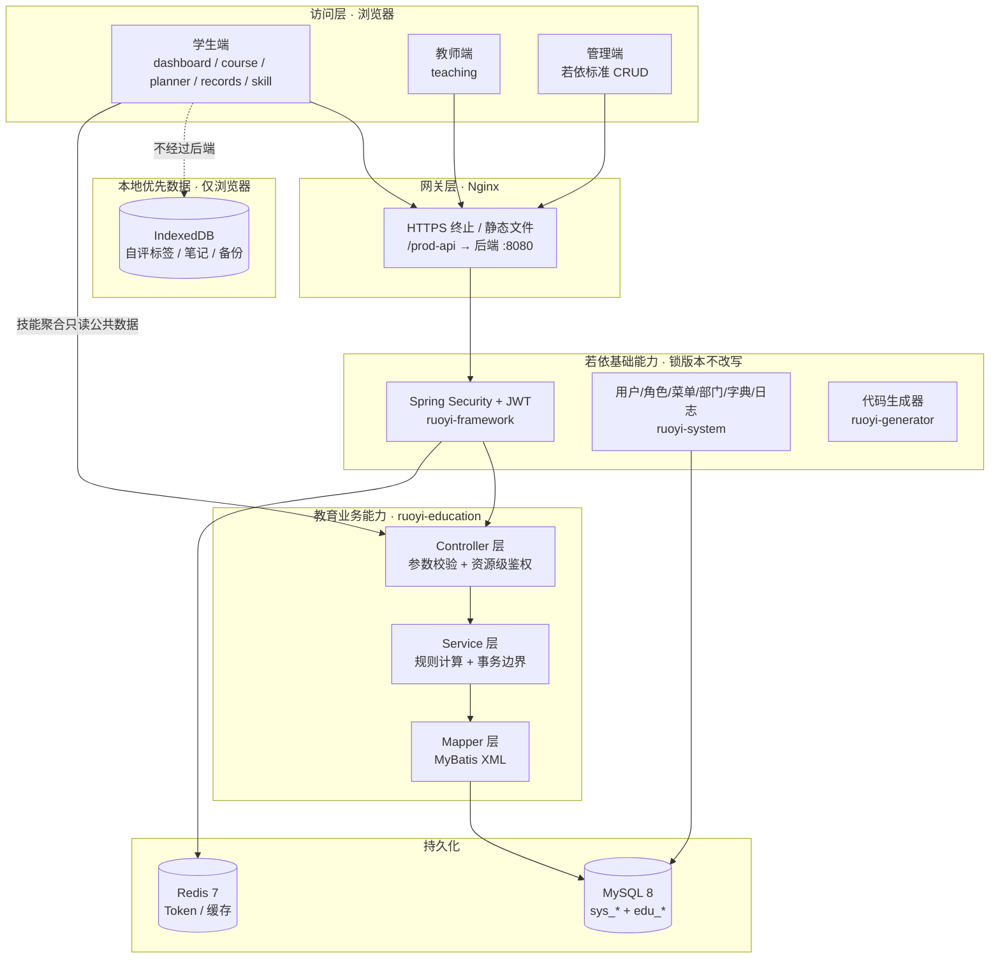
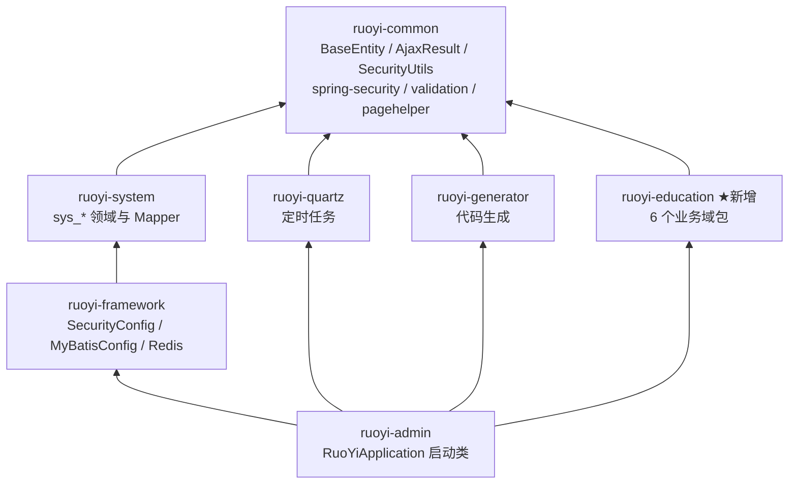
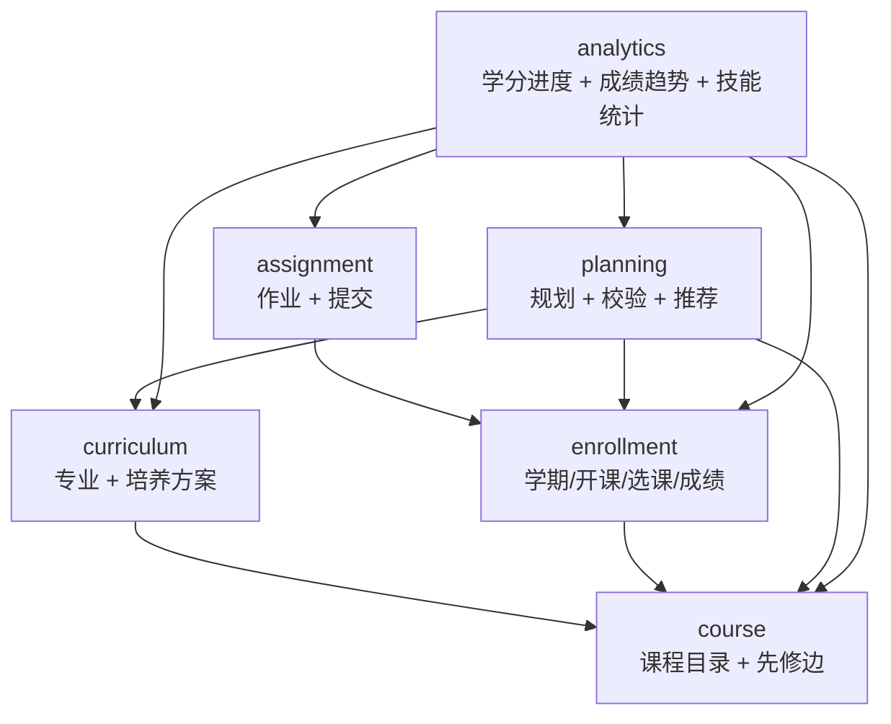

# 模块边界与分层

> 本文对应方案 ch.3「平台总体架构」与 ch.4「若依复用与二次开发清单」。
> 硬性编码约定见 [`backend-conventions.md`](backend-conventions.md)；
> 为什么这样切分见 [`adr/ADR-0002-module-boundaries.md`](adr/ADR-0002-module-boundaries.md)。

## 1. 逻辑分层（方案 ch.3.1）

六层，自上而下。**每一层只能依赖它下面那一层**，不允许反向依赖，也不允许跨层回调。

| 层 | 承担的功能 | 实现方式 | 本仓库落点 |
|---|---|---|---|
| **访问层** | 学生端 / 教师端 / 管理员端 | Vue 3 + Vue Router + Pinia + Element Plus | `frontend/`（官方 RuoYi-Vue3 TS 分支） |
| **网关 / 静态资源** | HTTPS、前端静态文件、反向代理、同域 API 转发 | Nginx | `deploy/`（自托管部署目录） |
| **若依基础能力** | 用户、角色、菜单、权限、日志、字典、代码生成 | RuoYi 既有模块，只装配不改写 | `backend/ruoyi-common`、`ruoyi-system`、`ruoyi-framework`、`ruoyi-quartz`、`ruoyi-generator` |
| **教育业务能力** | 课程、培养方案、选课、作业、规划、学情 | 新建 `ruoyi-education`，与底座隔离 | `backend/ruoyi-education` |
| **持久化** | 用户/课程/作业/学分等共享数据 | MySQL 8；Redis 保存框架 Token 与缓存 | `backend/sql/`（`ry_20260417.sql` + `edu/V1..V6`） |
| **本地优先数据** | 个人技能画像、私人笔记 | 浏览器 IndexedDB（Dexie.js）；跨设备同步留到后期 | 约定路径 `frontend/src/utils/education/skillProfileDb.ts` |



三层边界的具体含义：

- **网关层不承载业务**。Nginx 只做 TLS、静态文件、路径转发（`/prod-api/` → `http://backend:8080/`）
  与上传体积限制。任何「/api 路径改写到 /edu 路径」以外的逻辑都不该写在 Nginx 配置里。
- **若依基础能力不知道教育业务的存在**。`ruoyi-system` 里没有一行 `edu_` 代码；
  教育表也不进入若依的部门数据范围（`@DataScope`）。
- **本地优先数据层没有服务端副本**。IndexedDB 的数据不出浏览器，
  这是 [ADR-0004](adr/ADR-0004-local-first-skill-profile.md) 的结论，不是待办。

## 2. Maven 模块图

以下依赖关系取自各 `pom.xml` 的实际声明（`backend/pom.xml` 的 `<modules>` 与各子模块的
`<dependencies>`）：



要点：

| 事实 | 含义 |
|---|---|
| `ruoyi-education` **只依赖 `ruoyi-common`** | 拿得到 `BaseEntity`、`BaseController`、`AjaxResult`、`SecurityUtils`、`ServiceException`、`@PreAuthorize`、`@Log`、PageHelper，但拿不到 `ruoyi-system` 的 Service。教育业务不能直接操作 `sys_user` 表 |
| `ruoyi-education` **不依赖 `ruoyi-framework`** | 不许碰 `SecurityConfig`、`RedisConfig`、`DruidConfig`；需要的新配置放教育模块自己的 `@Configuration` |
| `ruoyi-admin` 依赖 `ruoyi-education` | 唯一的装配点：把教育模块放进启动类所在的可运行包 |
| 没有反向边 | `ruoyi-system` / `ruoyi-framework` / `ruoyi-common` 都不知道 `ruoyi-education` 存在 |

构建命令：

```bash
mvn -pl ruoyi-education -am test      # 只构建教育模块及其依赖
mvn -pl ruoyi-admin -am package      # 打可运行包
```

## 3. 内核零修改规则

**`ruoyi-admin` / `ruoyi-system` / `ruoyi-framework` 除依赖装配外不得修改。**
允许的改动只有两处，都已经完成：

| 文件 | 允许的改动 | 现状 |
|---|---|---|
| `backend/pom.xml` | `<dependencyManagement>` 增加 `ruoyi-education`；`<modules>` 增加 `<module>ruoyi-education</module>` | 已存在 |
| `backend/ruoyi-admin/pom.xml` | `<dependencies>` 增加对 `ruoyi-education` 的依赖 | 已存在 |

之所以能做到「零修改」，是因为若依的三处通配扫描已经把 `com.ruoyi.education.**` 覆盖进去了：

| 机制 | 配置位置 | 值 | 对教育模块的效果 |
|---|---|---|---|
| 组件扫描 | `backend/ruoyi-admin/src/main/java/com/ruoyi/RuoYiApplication.java` 上的 `@SpringBootApplication` | 基包 `com.ruoyi` | `com.ruoyi.education.*.controller` 下的 `@RestController` 自动注册，无需 `scanBasePackages` |
| Mapper 扫描 | `backend/ruoyi-framework/src/main/java/com/ruoyi/framework/config/ApplicationConfig.java` | `@MapperScan("com.ruoyi.**.mapper")` | `com.ruoyi.education.course.mapper.EduCourseMapper` 自动注册 |
| MyBatis 配置 | `backend/ruoyi-admin/src/main/resources/application.yml` | `typeAliasesPackage: com.ruoyi.**.domain`、`mapperLocations: classpath*:mapper/**/*Mapper.xml` | 实体别名与 `resources/mapper/education/*.xml` 自动加载 |

这条规则的操作含义：

- 需要新配置（例如教育模块的常量、校验器、图算法 Bean）→ 在
  `com.ruoyi.education.common.config` 下写 `@Configuration`，不要改 `ruoyi-framework`。
- 需要新权限标识 → 写进 [`V2__edu_permissions.sql`](../../backend/sql/edu/V2__edu_permissions.sql)
  的 `sys_menu` 插入语句，不要改若依的 `SysMenuServiceImpl`。
- 确实必须改内核（例如框架 bug）→ 先在 `docs/architecture/adr/` 记一条 ADR，
  写清「改了哪个文件、为什么非改不可、如何回归、升级时怎么合并」，再提 PR。
  **没有 ADR 的内核改动一律拒绝合并。**

## 4. 按域分包规则（package-by-domain）

`backend/ruoyi-education/src/main/java/com/ruoyi/education/` 下：

```text
com.ruoyi.education
├── common/                    域内共享，不放业务规则之外的任何东西
│   ├── enums/                 RequirementType / PlanItemStatus / PlanStatus
│   │                          EnrollmentStatus / RecordStatus / AssignmentStatus
│   ├── PrerequisiteGraph      先修图：loadGraph / isSatisfied / missingPrerequisites / detectCycles
│   ├── CreditCalculator       学分汇总与分类统计
│   └── config/                教育模块自己的 @Configuration
├── course/
│   ├── domain/                EduCourse、EduCoursePrereq（继承 BaseEntity）
│   ├── dto/                   CourseQuery、PrereqBody、CourseVO
│   ├── mapper/                EduCourseMapper、EduCoursePrereqMapper
│   ├── service/               IEduCourseService
│   ├── service/impl/          EduCourseServiceImpl
│   └── controller/            EduCourseController
├── curriculum/                同上六层
├── enrollment/                同上六层；另有 support/（EduIdentityResolver：
│                              把 SecurityUtils.getUserId() 翻译成 student_id / teacher_id）
├── assignment/                同上六层
├── planning/                  同上六层；另有 rule/（PlanRuleEngine 等规则实现）
│                              与 spi/（向其他域暴露的只读查询契约）
└── analytics/                 同上六层；另有 util/（GpaCalculator 等纯计算）
```

域内允许的额外子包（`planning/rule/`、`planning/spi/`、`enrollment/support/`、`analytics/util/`）
都是「同一个域的辅助层」，不是新业务域。新增子包时在 PR 说明里写清它的职责即可。

单元测试放同名包下的 `src/test/java/com/ruoyi/education/`：

```text
PrerequisiteGraphTest     先修图：组内 AND / 组间 OR / 最少阻力 / 环检测
PlanRuleEngineTest        规划规则：学分上限、未修筛选、理由生成
GradeUtilTest             等级制成绩与 GPA 换算
```

MyBatis XML 统一放：

```text
backend/ruoyi-education/src/main/resources/mapper/education/EduCourseMapper.xml
```

分包规则（评审时逐条检查）：

| 规则 | 说明 |
|---|---|
| **一个域 = 一个包** | 域的划分依据是「表的所有者」而不是「页面的归属」。`EduCourseOffering` 属于 `enrollment`，即使课程中心页面会显示它 |
| **域内六层固定** | `domain / dto / mapper / service / service/impl / controller`，缺层可以，加层需要说明（例如 `planning/rule/`） |
| **表只由所属域写** | 一个 Mapper 只操作本域的表。跨域读也必须走对方的 Service |
| **`common` 只放无状态的纯逻辑** | 先修图、学分计算、枚举。**不放**任何 Mapper、任何 `@Transactional`、任何 HTTP 相关的类 |
| **DTO 不跨域复用** | 每个域自己的 `*Query` / `*Body` / `*VO`。跨域传递用 domain 对象或 `common` 里的值对象，避免 `course` 改一个 DTO 弄坏 `planning` |
| **Controller 不做业务判断** | 只做参数绑定、`@Validated`、取当前用户、调 Service、包装 `AjaxResult` |

包可见性的现实约束：Java 包之间没有强制边界，`planning` 里的类**语法上**能直接 `new` 一个
`EduCourseMapper`。因此本规则靠三件事保证：

1. 评审（PR 里出现跨域 Mapper 注入一律打回）；
2. 依赖方向表（第 5 节）作为评审依据；
3. 域间接口只暴露 `I*Service`，Mapper 命名带域前缀便于肉眼发现越界。

目前**没有** ArchUnit 之类的自动化架构测试；引入它需要新增测试依赖，属于后续可选项。

## 5. 六个业务域的依赖方向



箭头 = 允许的调用方向（左边可以有右边类型的 Service 依赖）。

| 域 | 允许调用 | 禁止调用 | 理由 |
|---|---|---|---|
| `course` | 无（只依赖 `common`） | 其余全部 | 课程与先修边是全部规则的最底层事实；一旦它反过来依赖 `planning`，先修图就变成「规划依赖课程、课程依赖规划」的环 |
| `curriculum` | `course` | `enrollment`、`assignment`、`planning`、`analytics` | 条目要引用课程（`edu_curriculum_item.course_id`），但方案不知道学生是谁。方案必须能被**只有一个学生都没有**的环境导入 |
| `enrollment` | `course` | `curriculum`、`assignment`、`planning`、`analytics` | 开课引用课程；选课与成绩不关心培养方案（成绩是事实，进度是视图） |
| `assignment` | `enrollment` | 其余 | 作业挂在开课（`edu_course_offering`）上；教师归属校验必须复用 enrollment 的「这门课由谁授」判断，不能自己再写一遍 |
| `planning` | `course`、`curriculum`、`enrollment` | `assignment`、`analytics` | 见下方「为什么 planning 依赖三者」 |
| `analytics` | `course`、`curriculum`、`enrollment`、`assignment`、`planning` | 无（它是最上层） | 学情是全部事实的**派生视图**：学分进度要方案要求 + 已修成绩，待办数要作业，规划摘要要规划 |

### 5.1 为什么 `planning` 依赖 course + curriculum + enrollment，而反向永不成立

方案 ch.5.1 的规则顺序直接决定了依赖方向：

```text
① 读取已通过课程          → 需要 enrollment（edu_course_record）
② 先修依赖图判定          → 需要 course（edu_course_prereq + PrerequisiteGraph）
③ 培养方案未修筛选        → 需要 curriculum（edu_curriculum_item）
④ 学分上限 / 开课学期 / 时间冲突 → 需要 enrollment（edu_term + edu_course_offering）
⑤ 为每条生成可解释说明     → 把 ①-④ 的结论写回 edu_study_plan_item.reason
```

四个输入全部来自下层，`planning` 自己只有两张表（`edu_study_plan`、`edu_study_plan_item`），
没有对外提供事实的能力。所以：

- **反向依赖会制造环**：如果 `course` 需要知道「这门课被多少人规划」，它应该读
  `edu_study_plan_item`（自己写 SQL）或由 `analytics` 统计，**不能**调用
  `IPlanningService`。同理 `curriculum` 不能为了「方案完成率」调用 `planning`。
- **反向依赖会破坏可测试性**：`PrerequisiteGraph` 的单元测试要求不启动 Spring 容器
  （`backend-conventions.md` §7）。如果先修判定依赖 `IPlanningService`，测试就得拉起全链路。
- **反向依赖会让「方案导入」失败**：`V3`/`V4` 种子生成时只有课程与方案数据，没有学生、
  没有规划。`curriculum` 依赖 `planning` 会让这段数据加载无法单独执行。

`analytics` 是唯一的例外：它读所有域，但**只读**。它不写任何不属于自己的表，
也不被任何域依赖；如果某个域想要「统计」，正确做法是自己写聚合 SQL 或把需求交给 `analytics`
新增一个接口。

### 5.2 已知例外（当前为 0 处）

按当前代码实测（跨域 `import` 扫描），**没有任何一处违反上表**。

曾经存在、已在本次重构中消除的一处：

| 已消除的违反 | 原位置 | 处理结果 |
|---|---|---|
| `enrollment` → `analytics` | `enrollment/mapper/EduCourseRecordMapper.java` 的 `selectTermGradeRows` 曾返回 `analytics.dto.TermGradeRow`，让最底层域反向依赖最上层域 | 已把 `TermGradeRow` 移到 `com.ruoyi.education.enrollment.dto`（数据本就属于成绩表），删除 `analytics.dto` 下的副本，并同步 `EduCourseRecordMapper.xml` 的 `resultType`、`EduAnalyticsServiceImpl` 与 `GpaCalculator` 的 `import`。现在方向是 `analytics → enrollment`，符合方向矩阵 |

其余跨域 `import` 都符合方向矩阵：`curriculum → course`、`assignment → enrollment`、
`planning → {course, curriculum, enrollment}`、`analytics → {enrollment, assignment}`
（`analytics` 目前通过 SQL 直接读规划表，没有 `analytics → planning` 的 Java 依赖）。
这条扫描应当固化成 CI 检查（见 [`risks.md`](risks.md) R13）。

## 6. 前端与后端的边界

| 事项 | 归属 | 说明 |
|---|---|---|
| 规则计算（先修、学分、冲突、排序） | **后端** | 唯一实现是 Java 的 `PrerequisiteGraph` + `CreditCalculator`。前端只渲染 `validationStatus` / `reason` / `missing`，不得自己算一遍 |
| 权限判断 | **后端** | 前端 `v-hasPermi` 只控制按钮可见性（若依 `frontend/src/directive/`），**不是**授权 |
| 个人技能画像 | **前端本地** | IndexedDB + Dexie；服务端只有 `edu_skill_tag` / `edu_course_competency` 公共数据 |
| 课程筛选选项 | **后端** | `GET /edu/courses/options` 返回 `schools` / `categories` / `levels`，避免前端硬编码枚举 |
| 身份 | **后端** | 前端不发 `studentId` / `teacherId`；带 `me` 的接口全部由后端从 JWT 反查 |
| 展示用语 | **前端** | 「缺少先修课程 CSC3100」这类句子由后端给出（`validationMessage`），前端不做二次措辞 |

前端教育目录（已落地，路径见 [`README.md`](README.md) §5 的现状表）：

```text
frontend/src/api/education/          course.ts / curriculum.ts / enrollment.ts
                                     plan.ts / assignment.ts / analytics.ts
frontend/src/views/education/        dashboard/ course/ curriculum/ planner/
                                     records/ teaching/ skill/ analytics/
frontend/src/types/education/        index.ts（与 api-contract 对齐的 TS 类型）
frontend/src/utils/education/        skillProfileDb.ts（Dexie 封装）
```

新增教育页面时**不要**改 `frontend/src/{router,store,layout}` 的既有逻辑：
菜单与路由由 `sys_menu` 驱动（`V2__edu_permissions.sql` 的 `menu_id` 2000–2080），
权限字符串由后端下发。

## 7. 禁止事项

1. **禁止**把教育业务代码放进 `ruoyi-admin` / `ruoyi-system` / `ruoyi-framework`（含 Controller、Service、Mapper、Vue 之外的任何类）。
2. **禁止**修改若依内核而不写 ADR；`backend/pom.xml` 与 `ruoyi-admin/pom.xml` 之外的 pom 改动需说明。
3. **禁止**在 `ruoyi-education` 的 `pom.xml` 里加对 `ruoyi-system` / `ruoyi-framework` 的依赖。
4. **禁止**跨域直接注入别的域的 `Mapper`；跨域只能调用对方的 `I*Service`。
5. **禁止**在 `common` 包里放 Mapper、`@Transactional`、Controller 或任何有状态的单例。
6. **禁止**在 Controller 里写 SQL、开事务、算规则；Controller 只做绑定与包装。
7. **禁止**反向依赖：`course` / `curriculum` / `enrollment` / `assignment` 不得调用 `planning` 或 `analytics`。
8. **禁止**把 `@DataScope` 复制到教育表的 Mapper（教育表不使用若依部门数据范围）。
9. **禁止**信任前端传入的 `studentId` / `teacherId` 作为身份依据；一律 `SecurityUtils.getUserId()` 反查。
10. **禁止**用 `course_db_api_tables.sql` 或旧 FastAPI 服务作为数据来源或回滚路径（见 ADR-0005）。
11. **禁止**手工编辑 `V3..V6` 种子 SQL 或 `data/` 下的生成物；改生成器或改源数据后重跑。
12. **禁止**在 `pipeline/` 里新增「服务端运行时会调用」的脚本；`pipeline/` 是离线产出数据的工具，不是运行时模块。
13. **禁止**在 `ruoyi-education` 里写跨域的 JOIN 作为「默认做法」；确实需要时在 Mapper XML 里注明读的是哪张外部表、为什么不能拆成两次查询。
14. **禁止**新增第 7 个 Maven 业务模块或引入微服务组件（注册中心、网关、消息队列）而不写 ADR。
15. **禁止**把个人画像、私人笔记、自评数据写进任何 `edu_` 表（含 `remark`、日志与 `@Log` 的 `title`）。
