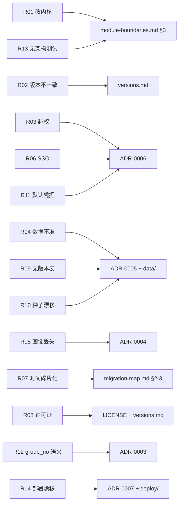

# 风险登记册

> 基线来自方案 ch.10「主要风险与应对」的 8 条。本文件在每条后面补上
> **本仓库现在已有的具体缓解措施**（可点击的落点），并追加 6 条重构期间识别的工程风险。
>
> 约定：「落点」只写仓库中真实存在的文件或「约定路径」（见 [`README.md`](README.md) §5）。
> 「措施」描述的是**已经存在于仓库里**的机制；尚未落地的部分明确写在措施里，不假装已完成。

## 1. 方案 ch.10 的原始风险

| # | 风险 | 影响 | 措施 | 落点 |
|---|---|---|---|---|
| R01 | **直接改若依内核** | 升级困难、`git merge` 持续冲突；官方文档与社区答案失效 | 教育业务全部放独立模块；内核模块允许的改动被限制为「两处 pom」：`backend/pom.xml` 的 `<dependencyManagement>` + `<modules>`，`backend/ruoyi-admin/pom.xml` 的一个 `<dependency>`。确需改内核必须先写 ADR | [`module-boundaries.md`](module-boundaries.md) §3 的允许改动表；[`ADR-0002`](adr/ADR-0002-module-boundaries.md)；`backend/pom.xml`、`backend/ruoyi-admin/pom.xml` |
| R02 | **版本不一致**（后端启动失败、接口或前端依赖冲突） | 环境不可复现；「只在我机器上能跑」；排障时间被版本差异吞掉 | 单一锁定文件记录后端 SHA `091a97b…`、前端 SHA `6054b23…`、JDK 21 / Node 24.16.0 / MySQL 8.0.43 / Redis 7 与 14 个核心依赖的精确版本；升级必须单独 PR + 五项 PoC；`frontend/package.json` 全部使用精确版本（无 `^`）。已知组合：`<java.version>17</java.version>` 在 JDK 21 上编译运行 | [`versions.md`](../../versions.md) §1–§2、§5；`backend/pom.xml` 的 `<properties>`；`frontend/package.json`；[`ADR-0001`](adr/ADR-0001-ruoyi-vue-baseline.md) |
| R03 | **学生与教师数据越权**（泄露成绩或作业） | 学生看到他人成绩；教师看到非本人课程的作业与评分；合规事故 | ① 菜单权限只控入口，数据归属一律在 Service 层校验；② 身份只从 `SecurityUtils.getUserId()` 派生，经 `uk_student_sys_user` / `uk_teacher_sys_user` 反查学籍；③ 教师归属按 `edu_course_offering.teacher_id`（`idx_offering_teacher`）；④ 越权与不存在返回同一错误；⑤ 越权用例必须进测试（`backend/ruoyi-education/src/test/...`，约定路径） | [`ADR-0006`](adr/ADR-0006-security-baseline.md)；[`backend-conventions.md`](backend-conventions.md) §4；[`api-contract.md`](api-contract.md) §0；[`er-diagram.md`](er-diagram.md) §5 的 `uk_student_sys_user`、`uk_teacher_sys_user`、`idx_offering_teacher` |
| R04 | **课程数据不准确**（推荐结果不可信） | 先修判定错、学分统计错、学生按错误建议选课 | ① 源数据固定为 `data/course_catalog/sis_course_outlines_export.xlsx` 与 `data/graduation_rules/`，可追溯到 SIS 原文；② 结构化不了的原文保留在 `edu_course.prereq_text` 与 `edu_course_prereq.raw_text`，可人工对账；③ 培养方案规则先经 AI 抽取再**人工复核**（`SDS_major_rules_summary.md`、`.agents/skills/extract-graduation-rules/`）；④ 生成物禁止手改，只改生成器或源数据后重跑；⑤ 成绩与条目保留快照字段，课程目录更新不会改写历史结论 | `data/course_catalog/`、`data/graduation_rules/SDS_major_rules_summary.md`、`.agents/skills/extract-graduation-rules/SKILL.md`、`pipeline/course_import/`、[`ADR-0005`](adr/ADR-0005-database-migration-strategy.md)、[`er-diagram.md`](er-diagram.md) §8 |
| R05 | **本地画像丢失**（用户学习记录消失） | 学生清浏览器数据/换设备后自评与笔记全部消失，且无法证明曾经存在 | ① 画像只存 IndexedDB（`dexie ^4.0.11`，约定路径 `frontend/src/utils/education/skillProfileDb.ts`）；② 导出/导入 JSON 备份作为一等功能，按钮权限 `edu:skill:export`（`menu_id=2071`）；③ 页面必须提示「清浏览器数据即丢失」；④ 跨设备加密同步延后，附四项复评清单 | [`ADR-0004`](adr/ADR-0004-local-first-skill-profile.md)；`backend/sql/edu/V2__edu_permissions.sql` 的 `menu_id=2071`；`frontend/package.json`（`file-saver 2.0.5`）；[`V1__edu_schema.sql`](../../backend/sql/edu/V1__edu_schema.sql) 末尾的「不建 `edu_user_profile`」注释 |
| R06 | **校方 SSO 接入受限**（无法按期用学校账号登录） | 若对外承诺「用学校账号登录」，交付时会违约 | MVP 只用内部账号（`V2` 的演示账号 + 若依 JWT）；身份映射表 `edu_sso_identity` 先建（`uk_sso_provider_subject`、`uk_sso_user_provider`），只存 `provider` + `external_subject`，不存学校密码；业务代码不耦合身份来源，接入时只替换「怎么拿到 `sys_user`」这一步；在对外文案与 [`migration-map.md`](migration-map.md) §3 中明确标注为延后项 | [`ADR-0006`](adr/ADR-0006-security-baseline.md) §4；[`er-diagram.md`](er-diagram.md) §5 的 `edu_sso_identity` 索引；[`migration-map.md`](migration-map.md) §3 |
| R07 | **大学生时间碎片化**（联调拖延、成员流失） | 里程碑滑期；模块负责人离场后无人接手 | ① MVP 边界写死（8 项能力，见能力对照表）；② 一个业务域一个包、一个负责人，缩窄交接面（`module-boundaries.md` §4）；③ 新人上手路径固定为「读 4 个契约文档 + 跑通 `RuoYiApplication`」，降低单人依赖；④ 每周必须有一次可运行演示（要求主干可运行，见 `feat/ruoyi-vue-refactor` 分支） | [`migration-map.md`](migration-map.md) §2 能力对照表与 §3 延后项；[`README.md`](README.md) §3 的分角色阅读顺序；[`module-boundaries.md`](module-boundaries.md) §4 |
| R08 | **源码许可证与第三方依赖合规** | 无法合规分发；商用或被质疑抄袭 | 官方 MIT 许可证原文保留；官方 README 原文保留；目录对应关系与提交号可查；第三方依赖清单集中在两个 `package.json` / `pom.xml`，新增依赖需同时更新 `versions.md` 并核对许可证；`pipeline/` 的 Python 依赖同样在 `requirements.txt` 中列明 | `backend/LICENSE`、`frontend/LICENSE`、`backend/README.ruoyi-vue.md`、`frontend/README.ruoyi-vue3.md`；[`versions.md`](../../versions.md) §1；`frontend/package.json`；`pipeline/career/requirements.txt` |

## 2. 重构期间识别的新增风险

| # | 风险 | 影响 | 措施 | 落点 |
|---|---|---|---|---|
| R09 | **迁移脚本没有版本记录表** | 无法自动判断某环境执行到 `V<n>` 的哪一步；结构与代码可能静默不一致，报错发生在运行时（列不存在/字段类型不符） | ① 执行顺序固定并写在 `versions.md` §4；② `V1`/`V2` 是「空库一次性脚本」，文件头注释与部署手册双重警示不可重跑；③ 上线前用 `information_schema` 对新旧环境的表/列/索引做一次对账；④ 后续引入 `V7__schema_history.sql` 记录已执行脚本，属新 ADR 范围 | [`versions.md`](../../versions.md) §4；[`ADR-0005`](adr/ADR-0005-database-migration-strategy.md) 的「后果」；`backend/sql/edu/V1__edu_schema.sql` 文件头注释 |
| R10 | **种子数据与源数据漂移**（`V3..V6` 是生成物，重跑结果可能与已提交内容不一致） | 演示数据与 `data/` 源文件脱节；评审看不到真实变更；上千行 SQL 的 diff 无法逐行审查 | ① 生成器与种子同步落地：`pipeline/course_import/build_edu_seed.py` 产出 `V3..V6`，并输出 `pipeline/course_import/seed-report.json`（行数/来源/告警）；② 幂等四规则（业务键 upsert、不硬编码自增主键、逐字节确定、重跑 `git diff` 为空）写进 ADR-0005 §4；③ 生成物禁止手改，改源数据后重跑；④ CI 以「重跑后 diff 为空」为校验门槛 | `backend/sql/edu/V3..V6__*.sql`、`pipeline/course_import/build_edu_seed.py`、`pipeline/course_import/seed-report.json`、[`ADR-0005`](adr/ADR-0005-database-migration-strategy.md) §4 |
| R11 | **默认凭据进入生产**（`token.secret` 为官方示例值、9 个演示账号密码统一 `admin123`、Swagger/Druid 控制台 `permitAll`） | 可伪造 Token；演示账号可直接登录看成绩；接口文档与数据库监控暴露攻击面 | ① `token.secret` 必须由环境变量覆盖；② 上线前改密码（含 `admin`，共 10 个账号）；③ 生产环境关闭 `springdoc` 与 Druid 控制台或加 IP 白名单；④ 全站 HTTPS 在部署层终止 | `backend/ruoyi-admin/src/main/resources/application.yml`（`token.secret`、`token.expireTime`）；`backend/sql/edu/V2__edu_permissions.sql` 的安全提示注释；`backend/ruoyi-framework/src/main/java/com/ruoyi/framework/config/SecurityConfig.java`；[`ADR-0006`](adr/ADR-0006-security-baseline.md) §5 |
| R12 | **`group_no` 的语义没有 schema 强制** | 任何人绕过 `PrerequisiteGraph` 直接写 SQL 判定，可能把「组内 AND」误实现成「组内 OR」，导致先修判定静默错误 | ① 语义只写在一个 ADR 里，评审时对照；② `PrerequisiteGraph` 的纯逻辑单测必须覆盖「组内 AND / 组间 OR / 多组取最少阻力 / 环检测」；③ 自依赖与环在**写入**与**计算**两侧都检测；④ DDL 已用 `ck_prereq_not_self` 与 `uk_course_prereq` 兜住两类最基础的错误 | [`ADR-0003`](adr/ADR-0003-prerequisite-group-semantics.md)；[`backend-conventions.md`](backend-conventions.md) §6；`backend/sql/edu/V1__edu_schema.sql` 的 `ck_prereq_not_self` |
| R13 | **单 Maven 模块没有自动化架构测试** | 跨域直接注入 Mapper、反向依赖（`course` 调 `planning`）编译期发现不了，只能靠评审 | ① 依赖方向矩阵 + 禁止事项清单作为评审脚本（`module-boundaries.md` §5、§7）；② `ruoyi-education/pom.xml` 只声明 `ruoyi-common`，把「不许依赖 `ruoyi-system`」变成编译期事实；③ 跨域只暴露 `I*Service`，Mapper 命名带域前缀便于肉眼发现；④ 引入 ArchUnit 属后续可选项（需新增测试依赖并更新 `versions.md`） | [`module-boundaries.md`](module-boundaries.md) §5、§7；`backend/ruoyi-education/pom.xml`；[`ADR-0002`](adr/ADR-0002-module-boundaries.md) 的「后果」 |
| R14 | **部署配置与运行时约定漂移**（Nginx 前缀、前端环境变量、后端 profile、数据库初始化四处必须说同一件事） | 「文档说能起来、实际起不来」；`/prod-api` 反代写错会让所有接口 404；初始化顺序被写错位置导致外键报错 | ① 路径约定写死并互相引用：`frontend/.env.production` 的 `VITE_APP_BASE_API = '/prod-api'` ↔ `deploy/nginx/nginx.conf` 的 `location /prod-api/ { proxy_pass http://backend:8080/; }`；② `deploy/docker-compose.yml` 编排后端 / 前端 / MySQL / Redis，后端 profile 见 `backend/ruoyi-admin/src/main/resources/application-docker.yml`；③ 数据库初始化顺序的唯一真源是 `versions.md` §4，`deploy/mysql/init/README.md` 只指向它、不复制一份；④ 密钥与密码只走 `deploy/.env.example` 声明的变量，不写进镜像 | `frontend/.env.production`、`deploy/nginx/nginx.conf`、`deploy/docker-compose.yml`、`deploy/.env.example`、`deploy/mysql/init/README.md`、`backend/ruoyi-admin/src/main/resources/application-docker.yml`、[`versions.md`](../../versions.md) §4 |

## 3. 风险与文档的对应关系

**复审节奏**：每个里程碑（方案 ch.9 的 5 个阶段）结束时，逐行确认措施是否仍然有效；
新增风险必须同时给出「落点」，只写「加强管理」「注意安全」的条目不予登记。
